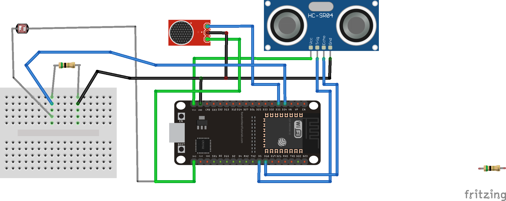
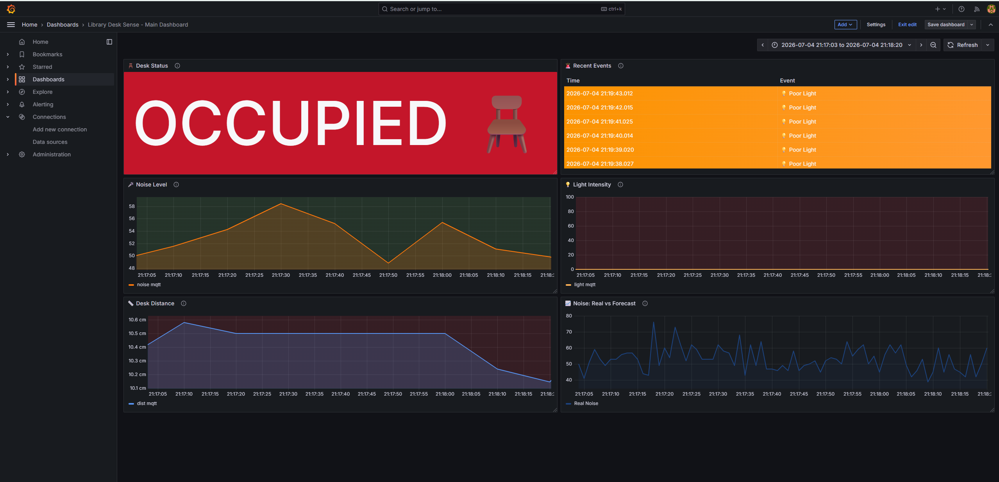

# 📚 LibraryDeskSense
### Smart Library Desk Occupancy & Environmental Monitoring System

[](https://docs.espressif.com/projects/esp-idf/en/v5.3.5/)
[](https://www.freertos.org/)
[](https://www.python.org/)
[](https://www.influxdata.com/)
[](https://grafana.com/)
[](LICENSE)

**LibraryDeskSense** is an end-to-end IoT system designed to monitor library desk occupancy and environmental conditions in real time. Built around an **ESP32 microcontroller**, it combines concurrent sensor acquisition, multi-protocol communication, remote configuration, time-series data storage, interactive visualization, and predictive analytics.

Developed as part of the **IoT Course at the University of Bologna**.

---

## 📑 Table of Contents

- [✨ Features](#-features)
- [🏗️ System Architecture](#️-system-architecture)
- [🔌 Hardware and Pinout](#-hardware-and-pinout)
- [🛠️ Technology Stack](#️-technology-stack)
- [📂 Repository Structure](#-repository-structure)
- [🚀 Getting Started](#-getting-started)
- [📊 Monitoring and Forecasting](#-monitoring-and-forecasting)
- [📡 Communication and Events](#-communication-and-events)
- [🔮 Future Improvements](#-future-improvements)
- [📄 License](#-license)

---

## ✨ Features

- 🪑 **Real-Time Desk Occupancy Detection** — Detects whether a library desk is occupied or free using an HC-SR04 ultrasonic distance sensor.
- 🌡️ **Environmental Monitoring** — Measures ambient light intensity and sound sensor levels to monitor desk conditions.
- ⚙️ **FreeRTOS Multitasking** — Uses ESP-IDF v5.3.5 and four dedicated tasks to manage sensor acquisition, communication, and system operations concurrently.
- 🔒 **Thread-Safe ADC Access** — Uses two mutexes to coordinate shared ADC resources and prevent concurrent hardware access conflicts.
- 🌐 **Multi-Protocol Communication** — Supports MQTT, HTTP POST, and CoAP POST for telemetry transmission.
- 🔄 **Dynamic Protocol Switching** — Allows the communication protocol to be changed at runtime through MQTT configuration topics.
- 🎛️ **Remote Configuration** — Updates sensor sampling intervals and detection thresholds without reflashing the firmware.
- 🚨 **Edge Event Detection** — Detects and publishes occupancy changes, high noise levels, and poor lighting conditions.
- 🐍 **Python Middleware** — Connects MQTT and HTTP ingestion to centralized data processing and storage using a Python proxy.
- 🗄️ **Time-Series Storage** — Stores telemetry and detected events in InfluxDB v2 for historical analysis.
- 📈 **Interactive Grafana Dashboard** — Visualizes sensor readings, current desk status, historical trends, and chronological events.
- 🤖 **ARIMA Forecasting** — Uses historical occupancy data to predict future desk availability and evaluates forecast performance with MAE and MSE.

---

## 🏗️ System Architecture

The system follows a modular IoT architecture, from edge sensing and local processing to centralized storage, visualization, and forecasting.

```text
┌─────────────────────────────────────────────┐
│                 ESP32 DEVICE                │
│            ESP-IDF + FreeRTOS               │
│                                             │
│  ┌────────────┐  ┌────────────┐ ┌─────────┐ │
│  │ HC-SR04    │  │ Sound      │ │ LDR     │ │
│  │ Occupancy  │  │ Sensor     │ │ Light   │ │
│  └────────────┘  └────────────┘ └─────────┘ │
│                                             │
│     Concurrent Tasks + Mutex Protection     │
│       Local Detection + Configuration       │
└──────────────────────┬──────────────────────┘
                       │
             MQTT / HTTP POST / CoAP
                       │
                       ▼
┌─────────────────────────────────────────────┐
│              PYTHON PROXY SERVER            │
│                                             │
│       MQTT Subscriber + Flask HTTP API      │
│          Telemetry and Event Handling       │
└──────────────────────┬──────────────────────┘
                       │
                       ▼
┌─────────────────────────────────────────────┐
│                 INFLUXDB v2                 │
│          Time-Series Data Storage           │
│                                             │
│            Telemetry + Event History        │
└──────────────────────┬──────────────────────┘
                       │
                       ▼
┌─────────────────────────────────────────────┐
│               GRAFANA OSS                   │
│                                             │
│     Live Dashboard + Historical Analytics   │
└──────────────────────┬──────────────────────┘
                       │
                       ▼
┌─────────────────────────────────────────────┐
│             ARIMA FORECASTING               │
│                                             │
│       Occupancy Prediction + MAE / MSE       │
└─────────────────────────────────────────────┘
```

### 🔁 Data Flow

1. **Sensing:** The ESP32 collects distance, sound, and light readings.
2. **Processing:** FreeRTOS tasks handle sensor acquisition, occupancy detection, and environmental event detection.
3. **Transmission:** Telemetry is transmitted through the configured MQTT, HTTP, or CoAP communication path.
4. **Ingestion:** The Python proxy receives supported MQTT and HTTP messages and processes incoming data.
5. **Storage:** Telemetry and events are written to InfluxDB v2.
6. **Visualization:** Grafana displays real-time measurements, desk status, historical trends, and events.
7. **Prediction:** ARIMA analyzes historical occupancy data to forecast future occupancy patterns.

---

## 🔌 Hardware and Pinout

The following components are connected to the ESP32 development board.

| Component | ESP32 GPIO | Interface | Purpose |
|---|---|---|---|
| HC-SR04 TRIG | GPIO 5 | Digital output | Triggers ultrasonic measurement |
| HC-SR04 ECHO | GPIO 18 | Digital input | Measures echo pulse duration |
| LDR Photoresistor | GPIO 34 | ADC1 Channel 6 | Measures ambient light intensity |
| Analog Sound Sensor | GPIO 35 | ADC1 Channel 7 | Monitors sound sensor output |

### 🧩 Hardware Notes

- **HC-SR04:** Uses ultrasonic pulse timing to estimate the distance between the sensor and nearby objects.
- **LDR:** Connected to an analog voltage-divider circuit with a 5 kΩ pull-down resistor.
- **Sound Sensor:** Its analog output is sampled to monitor sound levels and detect threshold exceedances.
- **ADC Access:** Mutex protection coordinates access to shared ADC resources.

> ⚠️ **Important:** The HC-SR04 ECHO output is typically 5 V. Use an appropriate voltage divider or level shifter before connecting it to an ESP32 GPIO, which is not 5 V tolerant. Ensure the sensor's analog outputs also remain within the ESP32's permitted input range.

### 🖼️ Hardware Wiring Diagram

The complete circuit layout is available in the repository:



---

## 🛠️ Technology Stack

| Technology | Role |
|---|---|
| **ESP32** | Edge device and sensor interface |
| **ESP-IDF v5.3.5** | Native embedded development framework |
| **FreeRTOS** | Concurrent task execution and synchronization |
| **C** | Embedded firmware implementation |
| **MQTT** | Publish/subscribe messaging and remote configuration |
| **HTTP POST** | Telemetry ingestion through the Python proxy |
| **CoAP POST** | Lightweight constrained-device communication |
| **Python** | Middleware, message processing, and HTTP server |
| **Flask** | HTTP API for incoming telemetry |
| **Paho MQTT** | MQTT client integration |
| **InfluxDB v2** | Time-series data storage |
| **Grafana OSS** | Monitoring and visualization |
| **ARIMA** | Time-series occupancy forecasting |
| **MAE / MSE** | Forecast evaluation metrics |

---

## 📂 Repository Structure

```text
LibraryDeskSense/
│
├── esp32/
│   ├── main/
│   │   ├── library_desk_sense.c
│   │   └── CMakeLists.txt
│   └── CMakeLists.txt
│
├── server/
│   └── proxy.py
│
├── docs/
│   ├── LibraryDeskSense Presentation.pdf
│   ├── LibraryDeskSense Presentation.pptx
│   ├── ESP32_Boards_bb.png
│   ├── grafana.png
│   └── Real vs Forecast.png
│
├── .gitignore
├── LICENSE
└── README.md
```

### 📁 Main Components

- `esp32/main/library_desk_sense.c` — ESP32 firmware, FreeRTOS tasks, sensor handling, Wi-Fi connectivity, communication protocols, event detection, and runtime configuration.
- `server/proxy.py` — Python middleware integrating MQTT ingestion, Flask HTTP endpoints, and InfluxDB writes.
- `docs/` — Project presentation, hardware wiring diagram, dashboard screenshot, and forecasting visualization.
- `LICENSE` — MIT License terms.

---

## 🚀 Getting Started

### ✅ Prerequisites

Before starting, ensure you have the following installed and configured:

- An ESP32 development board and the required sensors.
- [ESP-IDF v5.3.5](https://docs.espressif.com/projects/esp-idf/en/v5.3.5/) with the appropriate toolchain.
- Python 3 and pip.
- [Eclipse Mosquitto](https://mosquitto.org/) or another compatible MQTT broker.
- [InfluxDB v2](https://docs.influxdata.com/influxdb/v2/).
- [Grafana OSS](https://grafana.com/oss/grafana/).

### 1️⃣ Configure the ESP32 Firmware

Open the ESP-IDF terminal and navigate to the firmware directory:

```bash
cd esp32
```

Open `main/library_desk_sense.c` and configure your Wi-Fi credentials and the IP address of the machine running the Python proxy.

```c
#define WIFI_SSID  "YOUR_WIFI_SSID"
#define WIFI_PASS  "YOUR_WIFI_PASSWORD"
#define SERVER_IP  "192.168.X.X"
```

Replace the example values with your actual network details. Ensure the ESP32 and proxy server can communicate over the network.

**Build, flash, and monitor the firmware:**

```bash
idf.py set-target esp32
idf.py build
idf.py -p COM5 flash monitor
```

Replace `COM5` with the serial port assigned to your ESP32. On Linux or macOS, use the appropriate device path.

> 💡 If the target has already been configured, you can generally skip `idf.py set-target esp32`.

### 2️⃣ Start the Supporting Services

Start the MQTT broker, InfluxDB v2, and Grafana.

Default local service addresses are commonly:

| Service | Default URL / Address |
|---|---|
| MQTT broker | `mqtt://localhost:1883` |
| InfluxDB v2 | `http://localhost:8086` |
| Grafana OSS | `http://localhost:3000` |

These are default examples; your actual configuration may differ.

**Before running the application:**

- Create or select an InfluxDB organization and bucket.
- Generate an InfluxDB API token with the necessary write permissions.
- Configure the MQTT broker address, port, and any required credentials.
- Ensure the proxy server's listening port is reachable from the ESP32.

### 3️⃣ Configure the Python Proxy

Navigate to the server directory:

```bash
cd server
```

Configure the InfluxDB connection settings in `proxy.py` using your actual values. For example:

```python
INFLUXDB_URL = "http://localhost:8086"
INFLUXDB_TOKEN = "YOUR_INFLUXDB_TOKEN"
INFLUXDB_ORG = "YOUR_INFLUXDB_ORG"
INFLUXDB_BUCKET = "YOUR_INFLUXDB_BUCKET"
```

> ℹ️ The variable names above illustrate typical InfluxDB settings. Adapt them to the configuration variables actually defined in `proxy.py`.

Install the required Python dependencies:

```bash
python -m pip install paho-mqtt flask influxdb-client
```

Start the proxy server:

```bash
python proxy.py
```

The proxy should now be ready to receive telemetry through its configured MQTT and HTTP interfaces.

> 🔐 **Security:** Never commit real Wi-Fi passwords, MQTT credentials, or InfluxDB tokens to a public repository. Use environment variables or a local configuration file excluded by `.gitignore` for sensitive values.

### 4️⃣ Configure Grafana

1. Open Grafana at `http://localhost:3000`.
2. Add InfluxDB as a data source.
3. Configure the InfluxDB v2 connection, organization, bucket, token, and query language used by your setup.
4. Create or import dashboard panels for sensor telemetry, desk occupancy, and detected events.
5. Verify that incoming measurements are appearing in InfluxDB and Grafana.

**Note:** Dashboard panels, data-source settings, and queries must match your actual InfluxDB schema. The repository structure described here does not imply that a preconfigured Grafana dashboard JSON is included.

---

## 📡 Communication and Events

### 🌐 Supported Communication Protocols

| Protocol | Function |
|---|---|
| **MQTT** | Telemetry messaging, event publication, and remote runtime configuration |
| **HTTP POST** | Sends telemetry to the Python proxy over HTTP |
| **CoAP POST** | Provides a lightweight alternative for constrained-device communication |

The firmware supports runtime protocol selection through MQTT configuration topics, allowing the transmission method to be changed without reflashing the ESP32.

The Python proxy handles MQTT and HTTP ingestion as described in the project architecture. CoAP ingestion requires a compatible receiver or forwarding path if CoAP messages must also be persisted by the proxy.

### 🚨 Event Detection

The system detects relevant changes in desk occupancy and environmental conditions.

| Event Topic | Meaning |
|---|---|
| `desk/events/occupied` | A transition to occupied desk status |
| `desk/events/released` | A transition to free desk status |
| `desk/events/high_noise` | Sound sensor readings exceed the configured threshold |
| `desk/events/poor_lighting` | Light sensor readings indicate insufficient lighting |

Detection thresholds and sampling intervals can be adjusted remotely through the firmware's supported MQTT configuration topics.

> The actual event payloads, configuration topic names, and threshold semantics depend on the firmware implementation.

---

## 📊 Monitoring and Forecasting

### 📈 Real-Time Grafana Dashboard

The Grafana dashboard provides an overview of the desk's status and environmental conditions.

Typical dashboard elements include:

- 🪑 **Desk Occupancy:** Current `OCCUPIED` / `FREE` state.
- 📏 **Distance Monitoring:** Ultrasonic distance measurements over time.
- 🔊 **Noise Monitoring:** Sound sensor readings and detected high-noise events.
- 💡 **Lighting Monitoring:** Light sensor measurements and poor-lighting events.
- 🕒 **Events Log:** A chronological view of detected occupancy and environmental events.
- 📉 **Historical Trends:** Time-series panels for analyzing changes throughout the day.



### 🤖 ARIMA Occupancy Forecasting

Historical occupancy measurements are analyzed using an **ARIMA (AutoRegressive Integrated Moving Average)** time-series model to estimate future occupancy patterns.

The forecasting workflow includes:

1. **Data Preparation:** Extract historical occupancy measurements and prepare a time-indexed series.
2. **Model Training:** Fit an ARIMA model to the historical observations.
3. **Forecast Generation:** Produce predictions for a 24-hour horizon.
4. **Performance Evaluation:** Compare predictions with actual observations using Mean Absolute Error (MAE) and Mean Squared Error (MSE).
5. **Visualization:** Plot actual and forecasted values for comparison.

The goal is to help identify occupancy trends and estimate future desk availability.


**Evaluation metrics**

- **MAE:** Measures the average absolute difference between predictions and actual values.
- **MSE:** Measures the average squared difference between predictions and actual values, penalizing larger errors more strongly.

Lower MAE and MSE values generally indicate better predictive accuracy when comparing models on the same dataset and evaluation interval.

> 📌 ARIMA forecast quality depends on the amount of historical data, the sampling frequency, the stationarity and structure of the occupancy series, and the selected model parameters. Actual performance should be assessed on held-out observations rather than training data alone.

---

## 🔮 Future Improvements

Potential extensions to LibraryDeskSense include:

- 📱 A mobile-friendly interface for checking desk availability.
- 🗺️ Multi-desk monitoring across an entire library.
- 📊 Occupancy heatmaps and daily or weekly usage statistics.
- 🧠 Comparison of ARIMA with alternative forecasting models.
- 🔋 Power optimization and low-power operating modes.
- 🔐 Secure MQTT communication using TLS and stronger device authentication.
- 🐳 Docker Compose deployment for simplified service orchestration.
- 🧪 Automated firmware, middleware, and data-pipeline tests.

---

## 🎓 Academic Context

**Project:** LibraryDeskSense — Smart Library Desk Occupancy and Environmental Monitoring System

**Course:** Internet of Things (IoT)

**Institution:** University of Bologna

The project demonstrates the integration of embedded systems, concurrent programming, IoT communication protocols, time-series databases, monitoring dashboards, and predictive analytics in a practical smart-library application.

---

## 📄 License

This project is distributed under the **MIT License**. See the [`LICENSE`](LICENSE) file for details.

---

⭐ **If you find this project useful, consider giving the repository a star!**